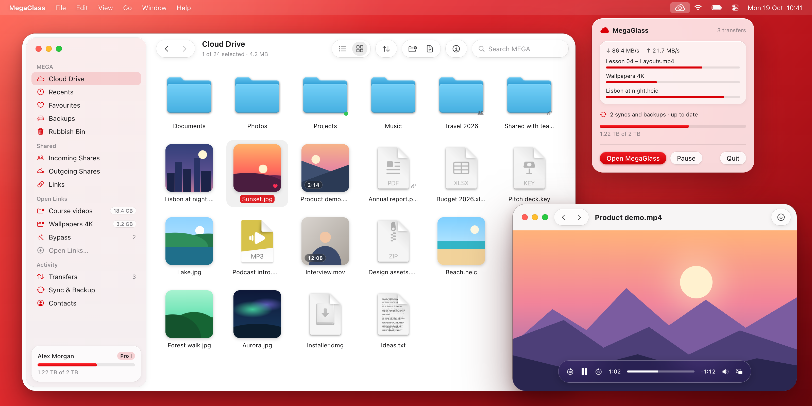

<div align="center">


# MegaGlass

**Open-source MEGA cloud client for the Mac.**<br>
Native, fast and private, with a Liquid Glass interface. No telemetry in the app.

[](#install)
[](https://github.com/meganz/sdk)
[](https://github.com/Turtlecute33/MegaGlass-macOS/releases)
[](LICENSE)



</div>

## About

MegaGlass is an unofficial client for [MEGA](https://mega.io) cloud storage on macOS 26 and
later. It uses the official MEGA C++ SDK, the same engine as the MEGA desktop and mobile apps,
with desktop transfer settings. The interface is SwiftUI. Chat and meetings are not included.

Also on Android: [MegaGlass-Android](https://github.com/Turtlecute33/MegaGlass-Android).

## Features

- **Cloud Drive**: list and grid views, thumbnails, search, sort, labels, favourites, Recents,
  Backups, Rubbish Bin and file versions.
- **Fast transfers**: 8 connections in each direction and hardware AES on all Apple Silicon
  chips. Pause, resume, retry and move to top.
- **Previews**: Quick Look, and video and audio streaming.
- **MEGA links**: open many file and folder links at the same time, with or without an account.
  Download them or import them to your Cloud Drive. Password-protected links work too.
- **Links from the browser**: `mega://` links, drag and drop, an opt-in clipboard watch and an
  optional browser router. MEGA and protector links open here, all other links go to your
  browser.
- **Bypass**: opens links behind link protectors and shorteners. It asks you only when all
  services fail.
- **Sync and backup**: two-way sync and one-way backup, with issue reports.
- **Sharing**: public links (expiry date and password on Pro), shared folders and contacts.
- **Account**: storage and transfer quota, two-factor authentication and password change.
- **Menu bar**: transfer and sync status. Transfers and syncs continue when you close the window.

## Install

```zsh
brew install --cask turtlecute33/tap/megaglass
```

Or download the disk image from [Releases](https://github.com/Turtlecute33/MegaGlass-macOS/releases)
and drag MegaGlass to Applications. To update, run `brew upgrade`.

MegaGlass is alpha software. Keep a copy of important files.

The app is signed, but Apple did not notarize it. On the first start, macOS blocks it. Click
**Done**, then go to **System Settings → Privacy & Security** and click **Open Anyway**. You do
this one time only: all releases have the same signing identity.

<details>
<summary><b>Uninstall</b></summary>

1. Log out in MegaGlass. An uninstall does not end the session on the MEGA server.
2. Run `brew uninstall --zap --cask megaglass`. This also deletes the session token and the
   Bypass API keys from the login Keychain.

Without Homebrew, delete the app. Then, in Keychain Access, delete the items
`app.megaglass.session` and `app.megaglass.bypass`.

</details>

## Privacy

- No telemetry or analytics in the app.
- The MEGA SDK sends some diagnostic events to MEGA, for example load times and errors. The SDK
  has no setting to turn them off.
- Your files are encrypted on your Mac before upload.
- The session token and the API keys are in the login Keychain. The app never stores your
  password.
- Copied MEGA links stay on this Mac (no Universal Clipboard). Clipboard history apps see them
  as concealed.
- Bypass sends protector links only to the services that you enable. It never sends your MEGA
  links.

<details>
<summary><b>Privacy and security details</b></summary>

- **SDK reports**: each time the account or a folder link loads, the SDK sends the load time and
  the item count. It also sends error events, for example a file that it cannot decrypt, or a
  sync or database problem.
- **Bypass**: it opens each protector link and its result pages from your internet address. It
  sends the link, and each link that a locker gives back (not the MEGA links), to the enabled
  third-party services, and loads their pages. These services have their own privacy policies.
  The rip.linkvertise.lol service uses the API host trw.lat. Links from the clipboard watch and
  the browser router go to Bypass with no other step. An API key goes only to its own API host,
  never on a redirect to another host.
- **Local network**: Bypass blocks addresses on this Mac and on the local network, by number or
  by local name (such as `.local`), also for the requests of a web page. It cannot block a public
  name that points to them.
- **Clipboard watch**: the app reads a copy only when macOS finds a web address in it. macOS
  gives that answer without the text.
- **Backups**: the list of open links (with their keys) is not in backups.
- **Logout without network**: the app logs out on this Mac and deletes the local cache. The
  session stays active on the MEGA server until it expires, or until you close it in MEGA on the
  web.
- **Caches**: thumbnails and previews use private cache folders. A preview becomes viewable only
  after the SDK completes it. The app removes preview files when you close the preview, and
  removes leftovers from a crash at the next start. At logout, the app removes the account
  thumbnails after the pending SDK writes finish.
- **Dependencies**: built from source at pinned versions, not from MEGA's prebuilt binaries
  (those have curl 8.1.2 and libsodium 1.0.16). curl 8.23.0 uses OpenSSL 3.6.5 for TLS and has
  only the HTTP and WebSocket protocols. The SDK authenticates the MEGA API by its pinned public
  key (`CURLOPT_PINNEDPUBLICKEY`). Transfer connections carry end-to-end encrypted data and do
  not check certificates. The pins do not update automatically: see
  [scripts/ports](scripts/ports/README.md).

</details>

## Build

Requirements: Apple Silicon, macOS 26 or later, Command Line Tools, and Homebrew packages
`cmake pkgconf autoconf automake libtool icu4c@78`.

```zsh
./scripts/bootstrap.sh    # MEGA SDK (pinned), patches, ICU headers, desktop config.h
./scripts/build-deps.sh   # curl, OpenSSL, Crypto++, libsodium, libuv from source (a few minutes)
./scripts/build-app.sh    # build/app.noindex/MegaGlass.app (--install copies it to /Applications)
```

`build-app.sh` runs the first two scripts again. They do nothing when `Vendor/` already has the
pinned versions.

The macOS 27 SDK declares SwiftUI `@State` as a macro, and its plugin ships only with Xcode.
Without Xcode, `build-app.sh` uses the macOS 26.5 SDK from the Command Line Tools.

<details>
<summary><b>Tests and benchmark</b></summary>

```zsh
./scripts/test.sh
```

The tests use Swift Testing, mock authentication and credentials, and fixed callback and file
system fixtures. They do not read a saved account, change the cloud, or change a real Keychain
item. In a restricted build environment, pass `--disable-sandbox -j 4` to SwiftPM.

Engine check without the UI (crypto speed, 100 MB public test download, folder link):

```zsh
SDKROOT=/Library/Developer/CommandLineTools/SDKs/MacOSX26.5.sdk swift run -c release megaglass-bench
```

The [stabilization report](docs/MACOS_ALPHA_STABILIZATION_REPORT.md) has the build evidence,
the open risks and the manual beta gates. The screenshot driver is a separate tool and uses a
saved account.

</details>

<details>
<summary><b>Performance</b></summary>

- **Desktop engine settings**: the SDK Swift package uses the iOS `config.h`, with 3 upload and
  4 download connections and 2 MB requests. MegaGlass uses the desktop values: 8 and 8
  connections, 16 MB requests.
- **Hardware AES on all Apple Silicon chips**: stock Crypto++ 8.9 uses the ARMv8 AES unit only
  for the "Apple M1" CPU name. MegaGlass builds Crypto++ with MEGA's patch. On an M5:
  AES-128-CTR 12.7 GB/s, CBC-MAC 1.3 GB/s.
- **More worker threads** for chunk encryption and MAC (a setting, default 4).
- **Responsive UI**: the UI reads the engine only on background queues and keeps copies of the
  nodes. The engine sorts folders in C++. The app merges transfer callbacks and shows them about
  6 times each second. It decodes thumbnails off the main thread and keeps them in a cache.

</details>

<details>
<summary><b>Releases and signing</b></summary>

- **Release**: set the version in `Resources/Info.plist` and commit. Then run
  `./scripts/release.zsh <version>`. It builds the signed app and the disk image and publishes
  the GitHub release. `scripts/update-tap.zsh` then points the cask in
  [homebrew-tap](https://github.com/Turtlecute33/homebrew-tap) to it.
- **Signing identity**: run `scripts/make-signing-identity.zsh` one time. It makes the stable
  self-signed identity that `build-app.sh` uses. Back up
  `~/.config/megaglass/macos-signing.keychain-db`. macOS asks before `build-app.sh` reads the
  keychain password: click **Allow**, not **Always Allow**. The signing keychain locks again
  after the build.
- **Older signing keychain**: if an older `make-signing-identity.zsh` made it, do this one time.
  In Keychain Access (login keychain), open the item "MegaGlass macOS signing keychain" (Where:
  `megaglass-macos-signing`). Select Access Control, then "Confirm before allowing access".
  Remove `security` from the list and click Save Changes.
- **Notarized app**: set `MEGAGLASS_SIGN_IDENTITY` (a Developer ID Application identity) and
  `MEGAGLASS_NOTARY_PROFILE` (a `notarytool store-credentials` profile).
- **No identity**: the app is signed ad hoc. After each rebuild, macOS can ask one time for
  Keychain access to the saved session. Select **Always Allow**.

</details>

<details>
<summary><b>Project layout</b></summary>

| Path | Contents |
|---|---|
| `Package.swift` | SDK targets (desktop settings, sync on), bridge, app, bench |
| `Sources/MEGABridge` | Objective-C++: sync and backup API, thumbnail processor, engine tuning |
| `Sources/MegaGlass/Engine` | SDK wrapper, async requests, node snapshots, thumbnails |
| `Sources/MegaGlass/Features` | Browser, transfers, sync, links, contacts, account, settings, preview |
| `patches/` | SDK patches: logout signature with sync on; sync safety (failed folder listings, changed volumes); local names in folder downloads |
| `scripts/` | Bootstrap, dependency build, app build, icon, signing identity, release, tap |

Not included: Finder integration (it needs Xcode and a paid developer account), chat and
meetings.

</details>

## License

MegaGlass is free software under the [GNU General Public License v3.0](LICENSE). It includes the
MEGA SDK (BSD 2-Clause) and other open-source libraries. Their licenses are in
[Resources/ThirdPartyNotices.txt](Resources/ThirdPartyNotices.txt). The app (Settings > General)
and the disk image include this file.

---

<sub>MegaGlass is an independent project. It is not affiliated with or endorsed by MEGA.</sub>
